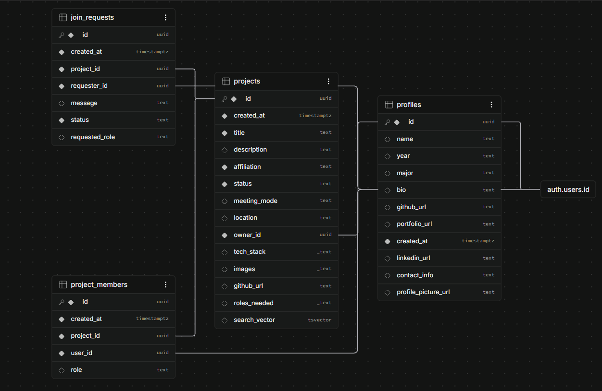

# Husky College Collaborator(CoCo Husky)

A school-specific platform where students can discover, post, and join projects with their peers — built as a personal/learning project to go deeper into full-stack development.

## The problem

Platforms like LinkedIn connect students to a global audience, but make it hard to find people to actually collaborate with locally. Husky Collaborator narrows the scope to a single school (verified via school email), making it easier to find real, reachable collaborators for class projects, personal builds, or just people interested in the same field.

## Features

- **School-verified auth** — signup restricted to a specific email domain, enforced server-side via a Supabase auth hook
- **Post projects** — title, description, tech stack, roles needed, GitHub link, and multiple images
- **Browse & search** — full-text search (title, description, tech stack, roles) plus filters for affiliation, status, and meeting mode
- **Request to join** — requesters can apply for a specific role; project owners review, accept, or decline
- **Automatic team membership** — accepting a request adds the person to the project's team with their requested role
- **Profiles** — editable bio/skills/links, avatar upload, and a public view showing a user's owned and joined projects
- **Project management** — owners can edit project details, add/remove images, or delete the project

## Tech stack

- **Frontend:** React (Vite), React Router
- **Backend:** Express.js
- **Database & Auth:** Supabase (PostgreSQL + Auth + Storage)
- **Email:** Brevo (custom SMTP for Supabase auth emails)
- **Hosting:** Vercel (frontend), Render (backend)

## Project structure

```
husky-collaborator/
  client/          React frontend (Vite)
    src/
      pages/       Route-level components (Browse, Profile, PostProject, etc.)
      components/  Shared components (Nav, ProtectedRoute)
      context/     AuthContext (session + profile-completeness state)
      lib/         Supabase client setup
  server/          Express backend
    routes/        Route definitions
    controllers/   Request handling logic
    middleware/     Auth verification
    lib/           Supabase client setup
```

## Running locally

### Backend
```
cd server
npm install
npm run dev
```
Requires a `.env` file with:
```
SUPABASE_URL=
SUPABASE_SERVICE_ROLE_KEY=
PORT=4000
```

### Frontend
```
cd client
npm install
npm run dev
```
Requires a `.env` file with:
```
VITE_SUPABASE_URL=
VITE_SUPABASE_PUBLISHABLE_KEY=
```

## Database

## Database

PostgreSQL via Supabase. Four core tables (`profiles`, `projects`, `join_requests`, `project_members`), connected by foreign keys with cascading deletes.



## Screenshots

**Browse projects**


**Profile**


**Requests for my projects**


**Post a project**


**Sign in**

## Status

Actively in development as a personal/learning project. Built solo, end-to-end, including auth design, API design, and database schema.
